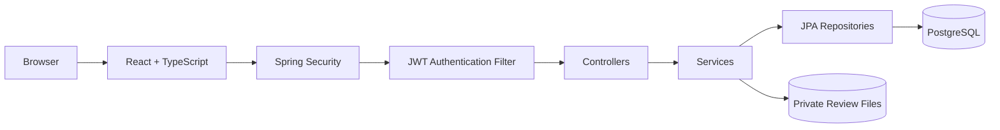

# EasyLang Activity Monitoring

<p align="center">
  
  
  
  
  
</p>

**Full-stack activity tracking system with secure authentication, role-based workspaces, and translator progress records.**

**Project status:** Sprints 1–4 are implemented locally. Translators can record daily work and rework pages, send weekly or final PDF/DOCX versions, receive correction feedback, and upload immutable corrected cycles. Chief Editors can work from an assigned queue, review PDFs in-app with linked marks, estimate checking time, compare the whole queue with their weekly availability, request correction with pages, or approve.

The repository contains an independent Spring Boot API and React/TypeScript frontend. The strongest part of the project is the security and access model: authentication is enforced on the server, protected again in the client, and tied to real database-backed roles.

## What stands out

- **Secure auth** — Spring Security + BCrypt + JWT stored in an `HttpOnly`, `SameSite=Lax` cookie.
- **CSRF protection** — the frontend requests and sends CSRF tokens for state-changing requests.
- **Double-layer RBAC** — Translator, Chief Editor, and Project Manager access is protected on both backend and frontend.
- **Activity workflow** — translators can view assigned activities, create/update work records and weekly estimates, finish eligible work, and submit it for checking.
- **Immutable document review** — validated PDF/DOCX bytes are stored privately per Review cycle with metadata and SHA-256; prior cycles are never replaced.
- **In-app PDF checking** — highlight, strike-through, and box marks (including scans) link to a comment list; one decision approves or returns the version.
- **Weekly and final versions** — a translator can send a weekly version without finishing, then complete the final version after Finish.
- **Correction loop** — assigned Chief Editors record feedback and a result; responsible translators receive a targeted notification and can upload the next cycle.
- **Relevant reminders** — persisted daily, weekly-estimate, weekly-submission, and correction prompts link to the missing work and disappear when no longer relevant.
- **Honest editor capacity** — the Chief Editor sets weekly availability; the workspace compares the whole open queue with it and counts unscored versions separately.
- **Database discipline** — PostgreSQL + Flyway migrations, constraints, uniqueness rules, and indexes.
- **Verification** — backend integration tests, frontend unit tests, lint/build gates, and Playwright end-to-end coverage.

## Request flow



## Roles

| Role | Workspace |
| --- | --- |
| Translator | Assigned activities, daily pages/rework, weekly estimates, reminders, weekly/final versions, marks, correction feedback and version history |
| Chief Editor | Assigned projects, open version queue, in-app PDF marks, expected time, availability/workload, feedback and decisions |
| Project Manager | Protected manager workspace |

## Run locally

```bash
docker compose up -d --wait

cd backend
mvn spring-boot:run
```

In another terminal:

```bash
cd frontend
npm install
npm run dev
```

Open `http://localhost:5173`.

## Verify

```bash
cd backend && mvn test
cd frontend && npm test
cd frontend && npm run lint
cd frontend && npm run build
```

Run the Sprint 4 PostgreSQL/security/cross-role browser flow in its own disposable cluster with `cd frontend && npm run test:e2e:sprint4-isolated`; see the [run guide](docs/run.md). Recorded results are in [Sprint 4 status](docs/SPRINT_4_STATUS.md).

## Delivery roadmap

| Phase | Status | Main outcome |
| --- | --- | --- |
| Sprint 1 | Complete locally | Authentication, role-based access, starter workspaces |
| Sprint 2 | Complete locally | Translator assignments, activity details, daily work records, history and filters |
| Sprint 3 | Complete locally | Weekly estimates, daily/weekly reminders, Finish, and submission with Review cycle 1 |
| Sprint 4 | Complete locally | Weekly/final versions, in-app PDF marks, correction pages/rework, editor capacity and approval |
| Sprint 5 | Planned | Project Manager creation, assignment, workload and risk monitoring |
| Sprint 6 | Planned | Integrated alpha workflow and demonstration |

See [Sprint 2 status](docs/SPRINT_2_STATUS.md), the [Sprint 2 process report](docs/SPRINT_2_PROCESS_REPORT.md), [Sprint 3 status](docs/SPRINT_3_STATUS.md), and [Sprint 4 status](docs/SPRINT_4_STATUS.md) for delivered behavior and verification. The current system is described in [architecture](docs/ARCHITECTURE.md), the [API contract](docs/API.md), the [design notes](docs/DESIGN.md), the [run guide](docs/run.md), and [STATE.md](docs/STATE.md).
